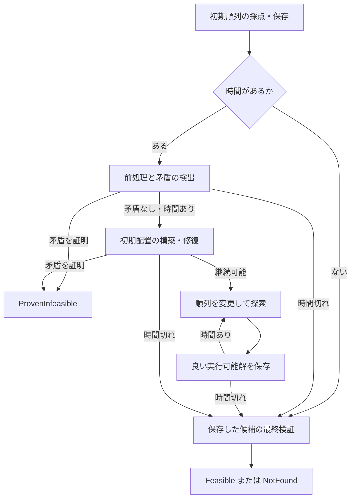

# LinearOrderingSolver ステップバイステップガイド

対象：`linear_ordering_solver_v10.hpp`。確認日：2026-10-14。C++20／GCC向け。

このガイドは、いくつかの項目を「どの順番に並べるか」を決めるライブラリを、小さなプログラムで学ぶ教材です。数学は高校までの和・不等式・指数関数を使います。C++の変数、配列、関数、ループは知っているものとし、ライブラリ固有の言葉と `span` などは登場時に説明します。

各ステップは独立した `main` を持つ完全なプログラムです。前のコードからの変更点を説明しつつ、共通部分も省略せず掲載します。設定値は説明用であり、あらゆる入力に最適な調整値ではありません。

| 学ぶ順序 | 内容 |
|---|---|
| 第1〜3節 | 対象問題、目的関数、類似ソルバー、実行準備 |
| ステップ01〜04 | 最小例、相反する希望、採点と改善、必須の前後関係 |
| ステップ05〜09 | 許可位置、固定、位置費用、有向隣接費用 |
| ステップ10〜15 | 費用の直接指定、一括入力、更新と解除、制約だけの問題 |
| ステップ16〜20 | 部分改善、結果の状態、探索中の違反、継続と複数の出発点 |
| ステップ21〜24 | 共通の締切、問題の所有、小数・最大化、外側の処理との組み合わせ |
| API索引・付録 | 全公開API、実装の流れと詳細、検証、参考資料 |

## 1. 何を解くライブラリか

### 1.1 「項目の番号」と「置く場所の番号」を分ける

たとえば、資料の3章を読みやすい順に並べたいとします。章に `0 = 基礎`、`1 = 応用`、`2 = 概要` という番号を付けます。この番号は章の名前の代わりであり、順番を変えても変わりません。

一方、並べる場所にも、左から `0, 1, 2` と番号を付けます。並び `[2, 0, 1]` は「場所0に概要、場所1に基礎、場所2に応用」です。配列の添字が場所、配列に入る値が項目の番号です。

全項目を重複なく1回ずつ並べたものを**順列**と呼びます。本ライブラリは、このような順列を返します。項目を省く、同じ項目を2回使う、空き場所を残す、といった問題ではありません。

### 1.2 費用で表す希望と、必ず守る条件

並びの良し悪しを、次の3種類の**費用**の合計で表します。費用は小さいほど良い値です。金額に限らず、読みづらさ、待ち時間に相当する点数、切り替え負担などを共通の単位に換算して構いません。

| 費用 | 意味 | 例 |
|---|---|---|
| 順序費用 | ある項目が別の項目より前なら加算する。離れていても対象 | 基礎より先に応用を置くと、説明不足として3点 |
| 位置費用 | ある項目を特定の絶対位置に置いたら加算する | 概要を最後に置くと5点 |
| 有向隣接費用 | ある項目の**直後**に別の項目が来たら加算する | 応用の直後に概要が来ると、話題の戻りとして2点 |

「できれば基礎を先に」は、違反したときの費用で表す**希望**です。「基礎より先に応用を置いてはいけない」は**必須条件**です。高い費用を付けることと、禁止することは同じではありません。他の費用との兼ね合いで希望を破った方が安くなることはありますが、必須条件を破る並びは採用できません。

必須条件として、項目間の先行関係、項目ごとの許可位置、特定位置への固定を表せます。既存の並びの一部だけを動かす指定もできます。全必須条件を満たす順列を**実行可能解**と呼び、その中で費用が最も小さいものを**最適解**と呼びます。

### 1.3 目的関数

項目数を $n$ とし、順列を $a=(a_ {0},a_ {1},\ldots,a_ {n-1})$ と書きます。最小化したい費用は、次の式です。

$$F(a)=K+\sum_ {0\leq p<q<n}C_ {a_ {p},a_ {q}}+\sum_ {p=0}^{n-1}U_ {a_ {p},p}+\sum_ {p=0}^{n-2}T_ {a_ {p},a_ {p+1}}$$

式に出てくる記号は、すべて次の意味です。

| 記号 | 意味 |
|---|---|
| $n$ | 項目の個数。項目番号も位置番号も $0$ から $n-1$ |
| $a$ | 比較対象の並び全体。全項目を1回ずつ含む |
| $p,q$ | 位置番号。第1の和では $p<q$、つまり前の位置と後ろの位置 |
| $a_ {p}$、$a_ {q}$ | それぞれ位置 $p,q$ に置かれた項目の番号 |
| $K$ | どの並びにも同じだけ加える定数費用 |
| $C_ {i,j}$ | 項目 $i$ が項目 $j$ より前にあるときの順序費用。$i,j$ は項目番号 |
| $U_ {i,p}$ | 項目 $i$ を絶対位置 $p$ に置く費用 |
| $T_ {i,j}$ | 項目 $i$ の直後が項目 $j$ のときの有向隣接費用 |
| $F(a)$ | 並び $a$ の総費用。ライブラリの返す `cost` に対応 |
| $\sum$ | 条件を満たす項を全部足す記号。対象がない和は0 |

第1の和は、前後に並ぶ**すべての組**を数えます。第2の和は**各項目を1回**数えます。第3の和は**連続する2項目**だけを数えます。項目が3個なら順序費用は3組、位置費用は3個、隣接費用は2組です。

`[2, 0, 1]` の費用を、和の記号を使わずに書くと次のとおりです。

$$F([2,0,1])=K+C_ {2,0}+C_ {2,1}+C_ {0,1}+U_ {2,0}+U_ {0,1}+U_ {1,2}+T_ {2,0}+T_ {0,1}$$

最後の項目から最初の項目に戻る費用 $T_ {1,2}$ は含めません。輪ではなく、始点と終点のある1列です。また、$C_ {i,j}$ と $C_ {j,i}$、$T_ {i,j}$ と $T_ {j,i}$ はそれぞれ別の値です。向きを逆にしても自動的に同じにはなりません。

指定しない費用は0です。定数 $K$ を足しても、並び同士の優劣は変わりません。対角成分 $C_ {i,i}$ と $T_ {i,i}$ は、同じ項目を2回使わないため採点に現れません。

### 1.4 制約を式で読む

項目 $i$ の位置を $\pi(i)$ と書きます。つまり $a_ {\pi(i)}=i$ です。必須の先行関係の集合を $E$、項目 $i$ の許可位置の集合を $D_ {i}$ とすると、守る条件は次の2つです。

$$\pi(i)<\pi(j)\quad\text{for every }(i,j)\in E$$

$$\pi(i)\in D_ {i}\quad\text{for every }i\in\{0,\ldots,n-1\}$$

$E$ に `(0, 1)` があれば項目0を項目1より前に置きます。$D_ {2}=\{0,2\}$ なら項目2を位置0か位置2に置きます。`fix_position` はこの集合を1か所に絞る操作です。部分改善では、指定した項目に対して、さらに「初期順列と同じ位置」という条件を追加します。

求めるものは「順列であり、これらの条件をすべて満たすものの中で、$F(a)$ ができるだけ小さい並び」です。

### 1.5 対象になること・ならないこと

この形で費用を表せる章順、工程順、表示順、作業の切り替え順などが対象です。一般の並べ替え関数のように、各項目の独立したキーだけで順番が決まるとは限りません。

一方、「直前3項目の組み合わせで費用が変わる」「作業時間の累計で制約が変わる」「複数機械の同時実行を割り当てる」といった条件をそのまま入力するAPIはありません。位置は経過時間ではなく、単なる何番目かです。独自の評価関数を渡すコールバックもありません。まず自分の問題が上の式と制約で表せるかを確認してください。

## 2. 類似ソルバーと、より限定された問題の解き方

本ライブラリは時間を指定して良い実行可能解を探すもので、返した解が最適であることは証明しません。特別な条件では、専用の厳密な方法の方が適しています。**厳密**とは、処理を完了した場合に最適性や解の不存在を確定できる、という意味です。本ライブラリと同じ最適解になることもあり、常に数値がさらに良くなるという意味ではありません。

### 2.1 条件を絞ると何が使えるか

| 問題の条件 | 候補と使い分け |
|---|---|
| $C=T=0$、先行制約なし。位置費用と許可位置だけ | 項目と位置の**最小費用割当**。ハンガリアン法や最小費用流などの厳密法で最適解を求められる。固定位置も許可集合で表せる。一般の順序費用や隣接費用を足すと、このままでは使えない |
| 費用はすべて0、許可位置は全位置、先行制約だけ | **トポロジカルソート**で、実行可能な順番を作るか、先行関係の循環を判定できる。これは費用の良い順番を選ぶ問題ではない |
| 非負の希望違反費用だけで、その希望と必須先行関係をまとめても循環がなく、位置制約なし | 希望もすべて満たすトポロジカル順なら費用0。費用は負にならないので、それが最適。希望に循環がある場合にはこの結論を使えない |
| 項目数が非常に小さい | 全順列を列挙して制約と費用を確認すれば厳密に解ける。例：5個は $5!=120$ 通り、10個は $10!=3,628,800$ 通り。$!$ は1からその数までの掛け算 |
| 隣接費用なしで、小さい項目集合を扱える規模 | 集合を状態にする動的計画法も厳密法の候補。隣接費用もある場合は末尾の項目を状態に加える方法がある。対象規模はメモリ・条件・実装によるため、固定の個数を目安にしない |
| ごく少数の項目だけを動かし、残りを固定 | 動かす項目の全配置を列挙する方法も候補。固定した項目との費用・先行関係、元の絶対位置での隣接を残して評価する必要がある |

上の表は、このライブラリの目的関数から条件を取り除いて得られる問題の対応です。これらの専用ソルバーへ自動的に切り替える機能は本ライブラリにはありません。

### 2.2 実際のソルバーとの使い分け

| 候補 | 適した場面 | 確認すること |
|---|---|---|
| 本ライブラリ | 順序・位置・隣接の費用を組み合わせ、既存の並びも使いながら短い時間で改善したい | 最適性証明はない。難しい制約では実行可能解を発見できないこともある |
| OR-Tools `SimpleLinearSumAssignment` | 純粋な最小費用割当 | 項目を「作業者」、位置を「仕事」と読み替えられる。一般の先行・順序・隣接費用は別のモデルが必要。費用は整数 [R1] |
| Boost Graph Library のトポロジカルソート | 費用のない必須先行関係だけ | 循環がない有向グラフが対象。C++版の出力は逆トポロジカル順である点にも注意 [R2] |
| OR-Tools CP-SAT／混合整数計画ソルバー | 最適性の証明や、時間・資源などのより複雑な制約が必要 | モデル化と外部依存が増える。CP-SATは整数でモデル化する。制限時間で終了した場合、最適性や実行可能性が未確定の場合もある [R3] |
| OR-Tools Routing など | 距離や切り替え費用を中心とする経路・配送問題 | 隣接費用だけの本モデルは、全項目を1回ずつ通る経路に対応する。通常の巡回セールスマン問題の閉路とは終端の扱いが違う。Routingも常に最適解を返すわけではない [R4] |

先行関係と希望に矛盾がなく、費用0の順番を簡単に作れるなら、時間を使って探索する必要はありません。反対に、希望が衝突し、位置や隣接の費用も重要で、良い既存順列を部分的に改善したい場面では、本ライブラリのAPIがそのまま役立ちます。

## 3. 実行の準備

配布ZIPには、このMarkdown、対象ヘッダー、`examples/` 内の全コード、まとめてコンパイル・実行する `check_examples.py` を入れています。追加の外部ライブラリは不要です。ただしヘッダーはGNU系の `bits/stdc++.h` を使うため、ここではLinux上のGCCを前提にします。任意のC++20コンパイラーだけでそのまま動くという意味ではありません。

本文のコードを `example.cpp` として保存し、同じフォルダーに `linear_ordering_solver_v10.hpp` を置けば、次のコマンドで動きます。

```bash
g++ -std=c++20 -O2 -Wall -Wextra example.cpp -o example
./example
```

`-std=c++20` はC++20を使う指定、`-O2` は最適化、`-Wall -Wextra` は警告の有効化、`-o example` は実行ファイル名です。ZIPを展開したフォルダーから最初の例を使う場合は、次のようにヘッダーの場所を `-I.` で教えます。

```bash
g++ -std=c++20 -O2 -Wall -Wextra -I. examples/step01.cpp -o example
./example
```

各コードは別々に実行します。複数の `main` を1つのプログラムにまとめてリンクしてはいけません。全例の確認には、ZIPのルートで `python3 check_examples.py` を実行します。

以降、`Solver` は長い型名に付ける別名です。`LinearOrderingSolver<>` の空の `<>` は標準の費用型 `int64_t`、つまり符号付き64ビット整数を使う意味です。費用・その差・途中の合計まで型の範囲に収まる入力を使います。入力1個ずつが範囲内でも、合計があふれるなら不正です。

コードの `assert(...)` は教材内の確認です。条件が偽ならその場で停止します。検証時には `-DNDEBUG` を付けず、これを有効にしてください。ヘッダー内の入力検査にも `assert` が使われるため、公開APIに不正な番号や壊れた順列を渡して回復を期待する使い方はできません。

## 4. 最小コードから始める


### ステップ01：2つの希望だけで順番を作る

まずは「概要2を基礎0より前」「基礎0を応用1より前」という2つの希望を表します。費用の種類や時間設定を増やす前に、問題を作る、希望を入れる、解く、結果を読む、という最小の流れを確認します。

ファイル：`examples/step01.cpp`

```cpp
#include "linear_ordering_solver_v10.hpp"

using Solver = LinearOrderingSolver<>;

int main() {
    Solver solver(3);
    solver.problem().add_preference(2, 0, 4);
    solver.problem().add_preference(0, 1, 3);
    auto r = solver.solve();
    if (r.status != Solver::Status::Feasible) {
        std::cerr << r << '\n';
        return 1;
    }
    std::cout << r << '\n';
}
```

1. `Solver solver(3)` は3項目の問題を所有するオブジェクトを作ります。引数 `3` は項目数です。初めはすべての費用が0で、どの項目も全位置に置けます。
2. `problem()` は、その問題に条件を設定する窓口を返します。別の問題を作っているわけではありません。
3. `add_preference(2, 0, 4)` の第1引数 `2` は先にしたい項目、第2引数 `0` は後にしたい項目、第3引数 `4` は希望を破った場合に払う非負の費用です。「項目0が項目2より前」なら4点、「項目2が項目0より前」なら0点です。
4. `add_preference(0, 1, 3)` も同じ読み方で、0より前に1を置くと3点です。2つの希望の費用を合計します。重みを必ず全部払うのではありません。
5. `solve()` は自分で出発点を用意して解きます。引数を省略したので標準設定です。目標時間は100,000マイクロ秒、つまり約0.1秒です。
6. 戻り値の `r` は `Result` です。`status` が `Feasible` のとき、`order` に実行可能な順列、`cost` にその総費用が入ります。`auto` は右辺から変数の型を決めるC++の書き方です。
7. `std::cout << r << '\n'` は結果全体を1行で表示します。`Result` 用の `operator<<` があるので、費用と順列を個別に表示するコードは不要です。`std::cerr << r << '\n'` ならデバッグ用の標準エラー出力へ書けます。演算子自身は改行しないため、最後の `'\n'` で改行しています。

`[2, 0, 1]` なら両方の希望を満たして費用0です。確認環境では `Result{status=Feasible, cost=0, order=[2, 0, 1]}` を得ました。この例では費用が非負なので、0なら人間にも最適だと分かります。ただし `Feasible` という状態自体は最適性の証明ではありません。時間や実行環境が変わった場合の出力一般を保証するものでもありません。

順列が20要素を超える場合、先頭20要素だけを表示し、末尾に `... (25 total)` のような省略記号と総要素数を付けます。20要素ちょうどなら省略しません。空の順列は `[]` です。表示を省略しても、`r.order` に入っている全要素は変わりません。

状態名は数値ではなく `Feasible`・`NotFound`・`ProvenInfeasible` で表示します。後ろ2つの状態では費用が有効でないため、`cost` 欄を省略します。たとえば未発見なら `Result{status=NotFound, order=[]}` です。この表示は人が読むデバッグ用で、出力結果を再び入力する保存形式ではありません。数値の小数桁などは出力先のストリーム設定に従います。

最初に `status` を確認する習慣を付けてください。未発見と解なしの違いはステップ17で扱います。


### ステップ02：希望が衝突したときと、時間・乱数の設定

ステップ01に「応用1を概要2より前にしたい」という希望を1つ加えます。2→0→1→2となり、3つを同時には満たせません。さらに、計算に使う目標時間と乱数の種を明示します。

ファイル：`examples/step02.cpp`

```cpp
#include "linear_ordering_solver_v10.hpp"

using Solver = LinearOrderingSolver<>;

int main() {
    Solver solver(3);
    auto& p = solver.problem();
    p.add_preference(2, 0, 4);
    p.add_preference(0, 1, 3);
    p.add_preference(1, 2, 1);

    Solver::Options options;
    options.time_limit_us = 20'000;
    options.seed = 7;
    auto r = solver.solve(options);

    if (r.status != Solver::Status::Feasible) {
        std::cerr << r << '\n';
        return 1;
    }
    assert(solver.is_feasible(r.order));
    assert(r.cost == solver.evaluate(r.order));
    std::cout << r << '\n';
}
```

`auto& p = solver.problem()` の `&` は参照、つまり元の問題に別名を付ける指定です。以降 `p` から設定できます。`auto p` と書くと問題のコピーになり、`solver` に設定が届きません。

追加した `add_preference(1, 2, 1)` は「項目1を項目2より前にしたい。破ったら1点」です。既存の4点・3点より小さいので、この希望をあきらめる方が安い場合があります。たとえば `[2, 0, 1]` は最後の希望だけを破り、費用1です。

`Options` は設定をまとめた構造体です。`solve(options)` の唯一の引数はこの設定です。

| ここで設定した値 | 意味 |
|---|---|
| `time_limit_us = 20'000` | 20,000マイクロ秒、約20ミリ秒を1回の呼び出し全体の終了目標にする。桁区切りの `'` は数値を変えない |
| `seed = 7` | 乱数の初期値。7自体に特別な意味はなく、別の整数にすると探索の選択が変わる |

既定のほかの設定は `deadline = Clock::time_point::max()`、`allow_infeasible_moves = false` です。それぞれ追加の締切なし、実行可能解を得た後は違反状態への移動を許可しない、という意味です。詳しくはステップ21と18で扱います。

同じ `seed` でも、時間で終了するため、CPUや負荷によって処理回数が変わり、結果が完全一致するとは限りません。時間指定も厳密な実時間上限ではなく、終了時の採点と検証などの時間は必要です。

末尾の2つの `assert` は「返った並びが制約を満たす」「返った費用を再計算しても同じ」を確認します。この2つのAPIを次の例で単独でも使います。


### ステップ03：既存の順列を採点してから改善する

ステップ02の問題設定は変えず、`solve` を `improve` に替えます。自分で作った順列を出発点にできます。

ファイル：`examples/step03.cpp`

```cpp
#include "linear_ordering_solver_v10.hpp"

using Solver = LinearOrderingSolver<>;

int main() {
    Solver solver(3);
    auto& p = solver.problem();
    p.add_preference(2, 0, 4);
    p.add_preference(0, 1, 3);
    p.add_preference(1, 2, 1);

    std::vector<int> initial{1, 0, 2};
    std::cout << "feasible = " << solver.is_feasible(initial) << '\n';
    auto before = solver.evaluate(initial);
    std::cout << "before = " << before << '\n';
    Solver::Options options;
    options.time_limit_us = 20'000;
    options.seed = 7;
    auto r = solver.improve(initial, options);
    assert(r.status == Solver::Status::Feasible && r.cost <= before);

    if (r.status != Solver::Status::Feasible) {
        std::cerr << r << '\n';
        return 1;
    }
    assert(solver.is_feasible(r.order));
    assert(r.cost == solver.evaluate(r.order));
    std::cout << r << '\n';
}
```

`std::vector<int> initial{1, 0, 2}` は、位置0に項目1、位置1に項目0、位置2に項目2を置いた順列です。`improve(initial, options)` の第1引数は**完全な順列**、第2引数は時間などの設定です。途中までの配列や重複した項目、未配置を示す `-1` は渡せません。

`is_feasible(initial)` は並びが有効な順列であり、必須条件も満たすかを返す真偽値です。この例には必須条件がないので1、つまり真です。壊れた順列に対しては偽を返すので、外部から受け取った配列を確認する入口にも使えます。

`evaluate(initial)` は現在の問題の目的関数を計算します。ここでは「2より前に0」が4点、「0より前に1」が3点で、合計7点です。`evaluate` は**必須条件への違反を罰金として足す機能ではありません**。有効な順列であれば、制約を破っていても式の費用を返します。

初期順列が実行可能なら、`improve` はそれを返却候補として保持します。返る実行可能解の費用は、現在の目的関数で採点した初期費用より悪くなりません。初期順列が制約を破る場合には修復を試みますが、その場合は修復前の費用以下にする保証はありません。

APIの型に現れる `std::span<const int>` は配列をコピーせず読み取るための「配列への窓」です。この例の `vector<int>` をそのまま渡せます。読み取り対象は呼び出し中に存在していればよく、返る `Result.order` は独立した配列です。


### ステップ04：希望と必須の先行関係を区別する

ステップ03の問題に「項目1は必ず項目2より前」という条件を加えます。費用の重みを巨大にする必要はありません。

ファイル：`examples/step04.cpp`

```cpp
#include "linear_ordering_solver_v10.hpp"

using Solver = LinearOrderingSolver<>;

int main() {
    Solver solver(3);
    auto& p = solver.problem();
    p.add_preference(2, 0, 4);
    p.add_preference(0, 1, 3);
    p.add_preference(1, 2, 1);

    p.require_before(1, 2);
    std::vector<int> initial{2, 0, 1};
    std::cout << "initial feasible = " << solver.is_feasible(initial) << '\n';
    std::cout << "initial cost = " << solver.evaluate(initial) << '\n';
    Solver::Options options;
    options.time_limit_us = 20'000;
    auto r = solver.improve(initial, options);

    if (r.status != Solver::Status::Feasible) {
        std::cerr << r << '\n';
        return 1;
    }
    assert(solver.is_feasible(r.order));
    assert(r.cost == solver.evaluate(r.order));
    std::cout << r << '\n';
}
```

`require_before(1, 2)` の第1引数は必ず先に置く項目1、第2引数は後に置く項目2です。2項目が隣り合う必要はありません。

初期順列 `[2, 0, 1]` は費用1ですが、この必須条件には違反するので `is_feasible` は0です。したがって出力の `initial cost = 1` は「採用可能で良い解」という意味ではありません。

`[1, 2, 0]` なら必須条件を満たし、希望 `0→1` を破る3点だけを払います。修復すると初期費用より増える可能性があることが分かります。`allow_infeasible_moves` を変更していなくても、**初期違反の修復は行います**。

先行関係はつながります。たとえば0を1より前、1を2より前としたなら、0も2より前になります。一方、0を1より前、1を0より前とすれば実行不能です。自分自身より前という条件も実行不能です。


### ステップ05：置ける位置を区間で制限する

ステップ04に補足章3を加え、補足は真ん中の位置1か2にだけ置けるようにします。項目数を4へ変更するため、位置番号も0〜3になります。

ファイル：`examples/step05.cpp`

```cpp
#include "linear_ordering_solver_v10.hpp"

using Solver = LinearOrderingSolver<>;

int main() {
    Solver solver(4);
    auto& p = solver.problem();
    p.add_preference(2, 0, 4);
    p.add_preference(0, 1, 3);
    p.add_preference(1, 2, 1);
    p.require_before(1, 2);
    p.set_position_range(3, 1, 3);
    Solver::Options options;
    options.time_limit_us = 20'000;
    auto r = solver.solve(options);

    if (r.status != Solver::Status::Feasible) {
        std::cerr << r << '\n';
        return 1;
    }
    assert(solver.is_feasible(r.order));
    assert(r.cost == solver.evaluate(r.order));
    std::cout << r << '\n';
}
```

`set_position_range(3, 1, 3)` の3つの引数は、順に「対象の項目3」「許可する最初の位置1」「許可する範囲の終わり3」です。範囲は **`[1, 3)`** で、1を含み3を含みません。したがって許可されるのは位置1と2です。

このような範囲を半開区間と呼びます。一般に `set_position_range(i, lo, hi)` は `lo <= 位置 < hi` を許可します。入力は `0 <= lo <= hi <= n` でなければなりません。`lo == hi` は空集合で、その項目をどこにも置けなくなります。

この設定は「項目3は項目1と項目3の間」という意味ではありません。ここでは後ろの2引数が**位置番号**です。既存の項目3の許可集合があれば、それをこの区間に置き換えます。


### ステップ06：飛び飛びの許可位置を指定する

ステップ05の補足章の配置ルールだけを変更し、今度は先頭か最後に置きます。区間では表せない穴のある集合です。

ファイル：`examples/step06.cpp`

```cpp
#include "linear_ordering_solver_v10.hpp"

using Solver = LinearOrderingSolver<>;

int main() {
    Solver solver(4);
    auto& p = solver.problem();
    p.add_preference(2, 0, 4);
    p.add_preference(0, 1, 3);
    p.add_preference(1, 2, 1);
    p.require_before(1, 2);
    std::vector<int> positions{0, 3};
    p.set_positions(3, positions);
    Solver::Options options;
    options.time_limit_us = 20'000;
    auto r = solver.solve(options);

    if (r.status != Solver::Status::Feasible) {
        std::cerr << r << '\n';
        return 1;
    }
    assert(solver.is_feasible(r.order));
    assert(r.cost == solver.evaluate(r.order));
    std::cout << r << '\n';
}
```

`set_positions(3, positions)` の第1引数は項目3、第2引数は許可する**位置番号の配列**です。`positions{0, 3}` なので先頭または最後です。項目0か項目3を選ぶ配列ではありません。

`set_positions` も以前の許可集合を置き換えます。配列は昇順でなくても構いません。重複した位置を渡しても、その場所が複数回使えるわけではありません。各位置番号は0〜`n-1` の範囲内である必要があります。

第2引数の型は `span<const int>` なので、このように `vector<int>` を用意すれば安全に渡せます。内容は問題側に取り込まれるため、設定後にこの `positions` を書き換えても設定は変わりません。空の配列を設定すると置ける場所がなくなります。


### ステップ07：制限を重ねる・固定する・解除する

ステップ06の設定に、担当者ごとの追加条件を重ねます。`set` は置き換え、`restrict` は共通部分への絞り込みです。

ファイル：`examples/step07.cpp`

```cpp
#include "linear_ordering_solver_v10.hpp"

using Solver = LinearOrderingSolver<>;

int main() {
    Solver solver(4);
    auto& p = solver.problem();
    p.add_preference(2, 0, 4);
    p.add_preference(0, 1, 3);
    p.add_preference(1, 2, 1);
    p.require_before(1, 2);
    std::vector<int> positions{0, 3};
    p.set_positions(3, positions);
    p.restrict_position_range(3, 1, 4);
    std::vector<int> further{2, 3};
    p.restrict_positions(3, further);
    p.fix_position(3, 3);
    std::vector<int> candidate{1, 2, 0, 3};
    assert(solver.is_feasible(candidate));
    p.clear_position_restriction(3);
    p.fix_position(3, 0);
    Solver::Options options;
    options.time_limit_us = 20'000;
    auto r = solver.solve(options);

    if (r.status != Solver::Status::Feasible) {
        std::cerr << r << '\n';
        return 1;
    }
    assert(solver.is_feasible(r.order));
    assert(r.cost == solver.evaluate(r.order));
    std::cout << r << '\n';
}
```

設定の変化を順番に追います。

| 呼び出し | 項目3に残る許可位置 | 引数の意味 |
|---|---|---|
| `set_positions(3, positions)` | `{0, 3}` | 項目3の許可集合を配列に置き換える |
| `restrict_position_range(3, 1, 4)` | `{3}` | 項目3の現在の集合と、位置1〜3の共通部分 |
| `restrict_positions(3, further)` | `{3}` | 項目3の現在の集合と、配列 `{2, 3}` の共通部分 |
| `fix_position(3, 3)` | `{3}` | 項目3の現在の集合と、位置3だけの共通部分 |
| `clear_position_restriction(3)` | `{0, 1, 2, 3}` | 項目3の位置制限をすべて解除 |
| `fix_position(3, 0)` | `{0}` | 制限を解除した項目3を位置0に固定 |

`fix_position(i, pos)` は以前の許可集合を無条件で上書きしません。たとえば `{3}` に絞ったまま位置0へ固定すると、共通部分がなく、実行不能です。「固定先を変更する」なら、例のように解除してから固定します。他の担当者の制限を保持すべき場合には、解除してはいけません。

`candidate` は途中の固定先3を満たすことを確認するだけで、最後の `solve` には渡していません。最後の結果では、項目3が位置0に来ます。この固定は問題に保存され、以後のすべての呼び出しに効きます。1回だけの固定はステップ16で扱います。


### ステップ08：位置によって費用を変える

ステップ03の3項目の問題へ戻り、「概要2を最後に置くのは避けたい」という追加の希望を入れます。今回は禁止ではなく、位置費用です。

ファイル：`examples/step08.cpp`

```cpp
#include "linear_ordering_solver_v10.hpp"

using Solver = LinearOrderingSolver<>;

int main() {
    Solver solver(3);
    auto& p = solver.problem();
    p.add_preference(2, 0, 4);
    p.add_preference(0, 1, 3);
    p.add_preference(1, 2, 1);

    p.set_position_cost(2, 2, 5);
    p.add_position_cost(2, 1, 2);
    Solver::Options options;
    options.time_limit_us = 20'000;
    auto r = solver.solve(options);

    if (r.status != Solver::Status::Feasible) {
        std::cerr << r << '\n';
        return 1;
    }
    assert(solver.is_feasible(r.order));
    assert(r.cost == solver.evaluate(r.order));
    std::cout << r << '\n';
}
```

`set_position_cost(2, 2, 5)` の引数は、項目2、絶対位置2、費用5です。式の $U_ {2,2}=5$ を設定します。`add_position_cost(2, 1, 2)` は項目2を位置1に置く費用に2を加えます。初めは0なので $U_ {2,1}=2$ です。位置0の費用は未指定の0のままです。

したがって概要を位置0・1・2へ置く追加費用は、順に0・2・5です。`set` は指定した1成分を上書きし、`add` はその成分に加算します。たとえば位置2の5点に別の理由で2点を足したければ `add_position_cost(2, 2, 2)` です。

位置費用は**その項目が実際に置かれた1か所分だけ**加算されます。3候補分を全部足すわけではありません。禁止したいなら費用ではなく、前のステップの許可位置APIを使います。


### ステップ09：直後のつながりに費用を付ける

ステップ08の設定に、「概要2の直後に基礎0が来ると4点」という切り替え費用を加えます。前後関係全体の費用との違いを確認します。

ファイル：`examples/step09.cpp`

```cpp
#include "linear_ordering_solver_v10.hpp"

using Solver = LinearOrderingSolver<>;

int main() {
    Solver solver(3);
    auto& p = solver.problem();
    p.add_preference(2, 0, 4);
    p.add_preference(0, 1, 3);
    p.add_preference(1, 2, 1);

    p.set_position_cost(2, 2, 5);
    p.add_position_cost(2, 1, 2);
    p.set_adjacent_cost(2, 0, 4);
    p.add_adjacent_cost(0, 2, 1);
    std::vector<int> a{2, 0, 1}, b{2, 1, 0};
    assert(solver.evaluate(a) == 5);
    assert(solver.evaluate(b) == 4);
    Solver::Options options;
    options.time_limit_us = 20'000;
    auto r = solver.solve(options);

    if (r.status != Solver::Status::Feasible) {
        std::cerr << r << '\n';
        return 1;
    }
    assert(solver.is_feasible(r.order));
    assert(r.cost == solver.evaluate(r.order));
    std::cout << r << '\n';
}
```

`set_adjacent_cost(2, 0, 4)` の第1引数は直前の項目2、第2引数は直後の項目0、第3引数は費用4です。離れている場合は加算しません。`add_adjacent_cost(0, 2, 1)` は逆方向の費用に1を加えます。両方向は独立です。

`[2, 0, 1]` は希望違反が1、位置費用が0、隣接費用が4なので合計5です。`[2, 1, 0]` は希望違反が4、位置費用が0、隣接費用が0なので合計4です。2が0より前という関係は同じでも、隣接しているかどうかで点数が変わります。

`[2, 1, 0]` の最後の0から最初の2に戻る1点は数えません。目的関数の隣接費用は `n-1` 本だけです。この違いは経路問題から移ってきたときに特に注意してください。


### ステップ10：順序費用を直接書く・負の費用と定数を使う

ステップ02の希望を、目的関数の行列Cへ直接書き換えます。その上で「0を1より前に置くと2点の得」と、全体に足す定数を加えます。

ファイル：`examples/step10.cpp`

```cpp
#include "linear_ordering_solver_v10.hpp"

using Solver = LinearOrderingSolver<>;

int main() {
    Solver solver(3);
    auto& p = solver.problem();
    p.set_order_cost(0, 2, 4);
    p.add_order_cost(1, 0, 3);
    p.add_order_cost(2, 1, 1);
    p.set_order_cost(0, 1, -2);
    p.set_constant_cost(10);
    p.add_constant_cost(2);
    std::vector<int> a{2, 0, 1};
    assert(solver.evaluate(a) == 11);
    Solver::Options options;
    options.time_limit_us = 20'000;
    auto r = solver.solve(options);

    if (r.status != Solver::Status::Feasible) {
        std::cerr << r << '\n';
        return 1;
    }
    assert(solver.is_feasible(r.order));
    assert(r.cost == solver.evaluate(r.order));
    std::cout << r << '\n';
}
```

`set_order_cost(i, j, value)` は「項目iが項目jより前なら払う費用」を上書きします。`add_order_cost(i, j, delta)` は同じ向きの費用に加算します。第1・第2引数はどちらも項目番号で、位置ではありません。

| 希望の書き方 | 同じ意味の費用の加算 |
|---|---|
| `add_preference(2, 0, 4)` | `add_order_cost(0, 2, 4)` |
| `add_preference(0, 1, 3)` | `add_order_cost(1, 0, 3)` |
| `add_preference(1, 2, 1)` | `add_order_cost(2, 1, 1)` |

希望と直接費用では、引数の向きが逆になることに注目してください。希望は「望ましい向き」を指定し、実際にはその逆向きに罰金を加えます。直接費用は「費用が発生する向き」を指定します。

`set_order_cost(0, 1, -2)` は0が1より前なら費用を2減らします。最小化なので、負の費用は得点に相当します。順序・位置・隣接・定数費用には負の値を使えますが、`add_preference` の重みは非負に限ります。

`set_constant_cost(10)` で定数を10に置き換え、`add_constant_cost(2)` で2足すため、定数は12です。引数はいずれも項目番号を伴わない費用そのものです。`[2, 0, 1]` では12に、`C[2,1]=1` と `C[0,1]=-2` を足して11になります。定数を変えても並びの優劣は変わりません。


### ステップ11：順序費用を疎なレコードでまとめて渡す

ステップ10の直接費用を、一括入力へ発展させます。指定する組が少ない場合は、値のある組だけを列挙できます。この例の費用はステップ02と同じです。

ファイル：`examples/step11.cpp`

```cpp
#include "linear_ordering_solver_v10.hpp"

using Solver = LinearOrderingSolver<>;

int main() {
    Solver solver(3);
    auto& p = solver.problem();
    std::vector<Solver::OrderTerm> terms{
        {0, 2, 1},
        {0, 2, 3},
        {1, 0, 3},
        {2, 1, 1}
    };
    p.set_order_terms(terms);
    std::vector<int> a{2, 0, 1};
    assert(solver.evaluate(a) == 1);
    Solver::Options options;
    options.time_limit_us = 20'000;
    auto r = solver.solve(options);

    if (r.status != Solver::Status::Feasible) {
        std::cerr << r << '\n';
        return 1;
    }
    assert(solver.is_feasible(r.order));
    assert(r.cost == solver.evaluate(r.order));
    std::cout << r << '\n';
}
```

**疎**とは、全組のうち指定する組が少ないことです。`OrderTerm` は `before`、`after`、`cost` の3つの値を持つ構造体です。`{0, 2, 1}` は「0が2より前なら1点」という直接費用であり、「0を2より前にしたい」という希望ではありません。

`set_order_terms(terms)` の引数はこのレコードの配列です。順序費用C**全体**を置き換えます。書かなかった組は0になります。U、T、定数、必須条件には影響しません。

最初の2レコードは同じ向きなので合計され、`C[0,2]=1+3=4` になります。逆向きのレコードは別の成分です。値が打ち消し合って0になった成分は、0として扱われます。

費用の出所が複数ある場合、それぞれをレコードとして追加してからまとめて渡せます。個別APIを大量に呼ぶ方法と、この一括入力方法を区別して覚えてください。


### ステップ12：順序費用を密な行列で渡す

ステップ11と同じ費用を、全成分を持つ配列で入力します。値のある組が多い場合に使う書き方です。

ファイル：`examples/step12.cpp`

```cpp
#include "linear_ordering_solver_v10.hpp"

using Solver = LinearOrderingSolver<>;

int main() {
    Solver solver(3);
    auto& p = solver.problem();
    std::vector<int64_t> c{
        0, 0, 4,
        3, 0, 0,
        0, 1, 0
    };
    p.set_order_costs(c);
    std::vector<int> a{2, 0, 1};
    assert(solver.evaluate(a) == 1);
    Solver::Options options;
    options.time_limit_us = 20'000;
    auto r = solver.solve(options);

    if (r.status != Solver::Status::Feasible) {
        std::cerr << r << '\n';
        return 1;
    }
    assert(solver.is_feasible(r.order));
    assert(r.cost == solver.evaluate(r.order));
    std::cout << r << '\n';
}
```

**密**な行列は、0の成分も含む全組の表です。行優先、つまり0行目、1行目、2行目の順に横へ読む並びで、`n*n` 個を1本の配列に入れます。ここでは `n=3` なので9個です。

| 行＝先の項目、列＝後の項目 | 列0 | 列1 | 列2 |
|---|---:|---:|---:|
| 行0 | 0 | 0 | 4 |
| 行1 | 3 | 0 | 0 |
| 行2 | 0 | 1 | 0 |

`c[i*n+j]` が `C[i,j]` です。たとえば `c[0*3+2]=4` は「項目0が項目2より前なら4点」です。コード上の改行は読みやすさのためで、実際の配列は1次元です。

`set_order_costs(c)` はC全体をこの配列へ置き換え、密形式にします。引数は `span<const Cost>` なので、費用型が標準の `int64_t` なら `vector<int64_t>` を渡します。その後も個別の `set_order_cost`・`add_order_cost` を使えます。

疎と密は同じ数式の別の入力形式です。常に密の方が速いとは限りません。ほとんどが0なら疎、多くの組を使うなら密を出発点にして、実際の入力で時間とメモリを確認します。


### ステップ13：位置費用と隣接費用も一括設定する

ステップ12に、ステップ09のUとTを行列で加えます。3つの費用表が同時に使われる例です。

ファイル：`examples/step13.cpp`

```cpp
#include "linear_ordering_solver_v10.hpp"

using Solver = LinearOrderingSolver<>;

int main() {
    Solver solver(3);
    auto& p = solver.problem();
    std::vector<int64_t> c{0, 0, 4, 3, 0, 0, 0, 1, 0};
    std::vector<int64_t> u{
        0, 0, 0,
        0, 0, 0,
        0, 2, 5
    };
    std::vector<int64_t> t{
        0, 0, 1,
        0, 0, 0,
        4, 0, 0
    };
    p.set_order_costs(c);
    p.set_position_costs(u);
    p.set_adjacent_costs(t);
    std::vector<int> a{2, 0, 1}, b{2, 1, 0};
    assert(solver.evaluate(a) == 5);
    assert(solver.evaluate(b) == 4);
    Solver::Options options;
    options.time_limit_us = 20'000;
    auto r = solver.solve(options);

    if (r.status != Solver::Status::Feasible) {
        std::cerr << r << '\n';
        return 1;
    }
    assert(solver.is_feasible(r.order));
    assert(r.cost == solver.evaluate(r.order));
    std::cout << r << '\n';
}
```

`set_position_costs(u)` は位置費用U全体、`set_adjacent_costs(t)` は隣接費用T全体を置き換えます。どちらも引数は行優先の `n*n` 個の費用です。行列の列の意味だけが異なります。

| 配列の成分 | 行の意味 | 列の意味 |
|---|---|---|
| `c[i*n+j]` | 先にある項目i | 後にある項目j |
| `u[i*n+pos]` | 配置する項目i | 絶対位置pos |
| `t[i*n+j]` | 直前の項目i | 直後の項目j |

Uの最後の行 `0, 2, 5` は、項目2を位置0・1・2へ置く費用です。Tの最後の行の先頭4は、項目2の直後に項目0が来る費用です。Tの0行2列の1は逆方向の費用です。

ステップ09と同じ2つの順列の費用を確認しています。個別指定と一括指定で意味が変わらないことが分かります。UとTには疎レコード用のAPIはなく、個別指定でも内部の表は密です。


### ステップ14：費用を更新する・種類ごとに消す

ステップ10の個別設定を使い、外側の処理で費用を変更する場面を扱います。`set` と `add` の違い、どの `clear` が何を消すかを、採点結果で確かめます。

ファイル：`examples/step14.cpp`

```cpp
#include "linear_ordering_solver_v10.hpp"

using Solver = LinearOrderingSolver<>;

int main() {
    Solver solver(3);
    auto& p = solver.problem();
    p.add_preference(2, 0, 4);
    p.add_preference(0, 1, 3);
    p.add_preference(1, 2, 1);

    std::vector<int> a{2, 0, 1};
    p.set_order_cost(0, 2, 8);
    p.add_order_cost(2, 1, 2);
    p.set_position_cost(2, 0, 5);
    p.add_position_cost(2, 0, -1);
    p.set_adjacent_cost(2, 0, 6);
    p.add_adjacent_cost(2, 0, -2);
    p.set_constant_cost(10);
    p.add_constant_cost(-3);
    assert(solver.evaluate(a) == 18);
    std::cout << "updated = " << solver.evaluate(a) << '\n';
    p.clear_order_costs();
    assert(solver.evaluate(a) == 15);
    p.clear_position_costs();
    assert(solver.evaluate(a) == 11);
    p.clear_adjacent_costs();
    assert(solver.evaluate(a) == 7);
    p.set_constant_cost(0);
    assert(solver.evaluate(a) == 0);
    Solver::Options options;
    options.time_limit_us = 20'000;
    auto r = solver.improve(a, options);

    if (r.status != Solver::Status::Feasible) {
        std::cerr << r << '\n';
        return 1;
    }
    assert(solver.is_feasible(r.order));
    assert(r.cost == solver.evaluate(r.order));
    std::cout << r << '\n';
}
```

新しい `set` の第3引数は**置き換え後の費用**、`add` の第3引数は**増減量**です。負の増減量なら減算になります。第1・第2引数はこれまでと同じく、C/Tでは項目と項目、Uでは項目と位置です。

`a=[2,0,1]` で実際に払うのは、Cの `2→1` が元の1に2を足した3、Uの `2を位置0` が5−1で4、Tの `2→0` が6−2で4、定数が10−3で7です。合計18です。Cの `0→2` を8に変えても、この順列ではその向きにならないので加算されません。

| API | 引数 | 消すもの | 残るもの |
|---|---|---|---|
| `clear_order_costs()` | なし | C全体 | U、T、定数、制約 |
| `clear_position_costs()` | なし | U全体 | C、T、定数、制約 |
| `clear_adjacent_costs()` | なし | T全体 | C、U、定数、制約 |
| `set_constant_cost(0)` | 新しい定数0 | 定数だけ | C、U、T、制約 |

問題を変更しても `solver` を作り直す必要はありません。内部の再利用情報は更新に応じて管理されます。ただし、すでに手元に保存した `Result.cost` は自動的には更新されません。過去の解を新しい条件で比較するときは、`evaluate` で再採点してください。


### ステップ15：先行関係をまとめて置き換える・制約だけを解く

ステップ14で費用をすべて消した問題を考えます。今回は順番の良さよりも、必須条件を満たす並びが欲しいケースです。先行関係を一括で入力します。

ファイル：`examples/step15.cpp`

```cpp
#include "linear_ordering_solver_v10.hpp"

using Solver = LinearOrderingSolver<>;

int main() {
    Solver solver(4);
    auto& p = solver.problem();
    std::vector<std::pair<int, int>> edges{{0, 2}, {1, 2}, {2, 3}, {0, 2}};
    p.set_precedences(edges);
    std::vector<int> first{0, 1, 2, 3};
    assert(solver.is_feasible(first));
    p.clear_precedences();
    p.require_before(3, 0);
    std::vector<int> positions{0, 2};
    p.set_positions(3, positions);
    Solver::Options options;
    options.time_limit_us = 20'000;
    auto r = solver.solve(options);

    if (r.status != Solver::Status::Feasible) {
        std::cerr << r << '\n';
        return 1;
    }
    assert(solver.is_feasible(r.order));
    assert(r.cost == solver.evaluate(r.order));
    std::cout << r << '\n';
}
```

`pair<int,int>` は2つの整数の組です。`edges` の `{0,2}` は「項目0を項目2より前にする」という必須の先行関係です。`set_precedences(edges)` の引数はその組の配列で、先行関係全体を置き換えます。費用や許可位置は変えません。同じ組を複数回書いても重複は統合されます。

この例はまず0→2、1→2、2→3を設定し、`first` が条件を満たすことを確認します。その後、引数なしの `clear_precedences()` で先行関係を全部解除し、3→0だけを追加します。最後に項目3の許可位置を0か2にします。最初の3本は、最後の問題には残っていません。

全費用が0なので、返る実行可能解の `cost` は0です。0だから制約が満たされていると判断するのではなく、`status` や `is_feasible` で確認します。制約だけの場合にもライブラリは残り時間の探索を続けることがあり、「最初の解で即終了する」指定はありません。

最初の先行関係だけで位置制約がないなら、第2節のトポロジカルソートも候補です。費用が0でも、一般の許可位置と先行関係を組み合わせると、単純に先行順で並べるだけでは配置できない場合があります。


### ステップ16：一部の項目だけを動かす

ステップ03の `improve` に第3引数を加えます。既存の資料の一部分だけを入れ替え、決定済みの章は動かしません。

ファイル：`examples/step16.cpp`

```cpp
#include "linear_ordering_solver_v10.hpp"

using Solver = LinearOrderingSolver<>;

int main() {
    Solver solver(6);
    auto& p = solver.problem();
    p.add_preference(3, 0, 8);
    p.add_preference(0, 1, 5);
    p.set_position_cost(3, 5, 4);
    p.set_adjacent_cost(2, 0, 7);
    p.set_adjacent_cost(2, 3, 1);
    std::vector<int> initial{4, 2, 0, 5, 1, 3};
    std::vector<uint8_t> movable{1, 1, 0, 1, 0, 0};
    Solver::Options options;
    options.time_limit_us = 20'000;
    auto r = solver.improve(initial, options, movable);
    assert(r.status == Solver::Status::Feasible);
    assert(r.order[0] == 4 && r.order[1] == 2 && r.order[3] == 5);
    assert(r.cost <= solver.evaluate(initial));

    if (r.status != Solver::Status::Feasible) {
        std::cerr << r << '\n';
        return 1;
    }
    assert(solver.is_feasible(r.order));
    assert(r.cost == solver.evaluate(r.order));
    std::cout << r << '\n';
}
```

第1引数 `initial` は全6項目の順列、第2引数 `options` は探索設定、第3引数 `movable` は項目ごとの可動フラグです。`uint8_t` は1バイトの符号なし整数です。ここでは0か1を入れます。API上は0が固定、0以外が可動です。

フラグの添字は**項目番号**です。`movable[0]=1` だから項目0を動かせます。`movable[2]=0` だから項目2を、初期配列中の位置1に固定します。位置2を固定する意味ではありません。

| 項目 | 初期位置 | フラグ | 扱い |
|---|---:|---:|---|
| 0 | 2 | 1 | 可動 |
| 1 | 4 | 1 | 可動 |
| 2 | 1 | 0 | 位置1に固定 |
| 3 | 5 | 1 | 可動 |
| 4 | 0 | 0 | 位置0に固定 |
| 5 | 3 | 0 | 位置3に固定 |

したがって動かせる場所は2、4、5です。固定項目が消えるわけではなく、費用も先行関係も全項目を含めて評価します。例の `set_adjacent_cost(2,0,7)` と `set_adjacent_cost(2,3,1)` は、固定した項目2の**直後の位置2**に誰を置くかで違います。可動項目だけの配列に縮めて採点すると、この費用を見落とします。

6要素のフラグを渡すか、空のフラグで全可動とします。省略時も全可動です。可動でも必須の先行関係や許可位置には従います。フラグによる固定はこの呼び出しだけに効き、`fix_position` のように問題を書き換えません。


### ステップ17：3種類の結果を正しく扱う

ステップ16の固定指定を含め、解が返らなかったときの意味を確認します。時間0で未発見になる例、循環がある例、固定を外すと解ける例、項目数0の例を並べます。

ファイル：`examples/step17.cpp`

```cpp
#include "linear_ordering_solver_v10.hpp"

using Solver = LinearOrderingSolver<>;

int main() {
    auto show = [](const char* label, const Solver::Result& r) {
        std::cout << label << ": " << r << '\n';
    };
    Solver::Options options;
    options.time_limit_us = 20'000;
    Solver possible(2);
    possible.problem().require_before(1, 0);
    Solver::Options zero;
    zero.time_limit_us = 0;
    auto limited = possible.solve(zero);
    assert(limited.status == Solver::Status::NotFound);
    show("zero budget", limited);
    show("with time", possible.solve(options));

    Solver cyclic(2);
    cyclic.problem().require_before(0, 1);
    cyclic.problem().require_before(1, 0);
    show("cycle", cyclic.solve(options));

    Solver restricted(2);
    restricted.problem().fix_position(0, 1);
    std::vector<int> initial{0, 1};
    std::vector<uint8_t> fixed{0, 0};
    show("fixed call", restricted.improve(initial, options, fixed));
    show("unfixed call", restricted.improve(initial, options));

    Solver empty(0);
    empty.problem().set_constant_cost(5);
    auto e = empty.solve(zero);
    assert(e.status == Solver::Status::Feasible && e.order.empty() && e.cost == 5);
    show("empty problem", e);
}
```

`show` は教材用の小さな表示関数をラムダ式で書いたものです。`label` は表示名、`r` は表示する `Result` への読み取り専用参照です。ソルバーの追加APIではありません。

| 状態 | 意味 | 呼び出し側の判断 |
|---|---|---|
| `Feasible` | 必須条件を満たす解を返した | `order` と `cost` を使える。最適性は未証明 |
| `NotFound` | この呼び出しでは実行可能解を発見しなかった | 解なしとは断定しない。初期順列、時間、固定条件などを見直せる |
| `ProvenInfeasible` | 矛盾を検出して実行不能と分かった | 入力条件を確認する。部分固定があれば、その固定を含めた問題の結論 |

`possible` には `[1,0]` という解があります。しかし `solve` の出発点 `[0,1]` は制約違反で、時間0では直す探索を行わないため `NotFound` です。`time_limit_us=0` は有効な指定です。実行可能な初期順列を `improve` へ渡す場合には、時間0でもその解を返せます。

`cyclic` は0→1→0という循環があり実行不能です。前処理が完了すれば `ProvenInfeasible` になります。ただし時間を極端に短くすると、矛盾の発見まで進まず `NotFound` のこともあります。

`restricted` 自体には `[1,0]` という解があります。最初の呼び出しは全項目を `[0,1]` の位置に固定したため、問題に設定した「項目0を位置1へ」と両立しません。ここでの `ProvenInfeasible` は**固定付きの呼び出し**についての結論です。フラグを省略した2回目では移動できます。

非実行可能な結果の `order` は空で、`cost=0` は有効な評価値ではありません。一方、`n=0` は正当な空問題で、空順列が `Feasible`、費用は定数5です。したがって `order.empty()` だけで成功・失敗を判定せず、必ず `status` を見ます。


### ステップ18：探索の途中だけ必須条件への違反を許す

ステップ04の修復とは別に、いったん実行可能になった後も、一時的に制約を破る途中状態を通れるようにします。返却される解の条件は変わりません。

ファイル：`examples/step18.cpp`

```cpp
#include "linear_ordering_solver_v10.hpp"

using Solver = LinearOrderingSolver<>;

int main() {
    Solver solver(3);
    auto& p = solver.problem();
    p.add_preference(2, 0, 4);
    p.add_preference(0, 1, 3);
    p.add_preference(1, 2, 1);

    p.require_before(1, 2);
    p.set_position_cost(2, 2, 5);
    p.set_adjacent_cost(2, 0, 4);
    std::vector<int> initial{1, 2, 0};
    assert(solver.is_feasible(initial));
    Solver::Options options;
    options.time_limit_us = 20'000;
    options.seed = 7;
    options.allow_infeasible_moves = true;
    auto r = solver.improve(initial, options);
    assert(r.status == Solver::Status::Feasible);
    assert(r.cost <= solver.evaluate(initial));

    if (r.status != Solver::Status::Feasible) {
        std::cerr << r << '\n';
        return 1;
    }
    assert(solver.is_feasible(r.order));
    assert(r.cost == solver.evaluate(r.order));
    std::cout << r << '\n';
}
```

追加した `allow_infeasible_moves = true` は、探索中の一時的な制約違反を許す設定です。実行可能な順列同士を直接行き来しにくいとき、違反を挟むことで別の良い配置へ進める可能性があります。アルゴリズムの詳細は付録で扱います。

`false` と `true` の意味を時点ごとに整理します。

| 場面 | `false`（既定） | `true` |
|---|---|---|
| 初期順列が制約違反 | 修復を試みる | 修復を試みる |
| 実行可能解を見つけた後 | 違反する移動を採用しない | 違反する途中状態も探索できる |
| 返す解 | 実行可能解だけ | 実行可能解だけ |

必須条件を希望へ変更する設定でも、違反解を返してよいという設定でもありません。この例では初期解が実行可能なので、良い解を見つけられなくてもそれが残ります。

常に品質が上がるとは限りません。違反状態の修復に時間を使うこともあります。同じ時間・複数の入力と種で比べ、役立つ問題で使います。なお、温度や移動の種類を直接指定する公開APIはありません。


### ステップ19：前回の結果から続きを改善する

ステップ03の `improve` を、短い呼び出しに分けて繰り返します。画面更新や他の処理の合間に、現在の最良順列を引き継ぐパターンです。

ファイル：`examples/step19.cpp`

```cpp
#include "linear_ordering_solver_v10.hpp"

using Solver = LinearOrderingSolver<>;

int main() {
    Solver solver(5);
    auto& p = solver.problem();
    p.add_preference(4, 0, 8);
    p.add_preference(0, 1, 5);
    p.add_preference(1, 2, 3);
    p.add_preference(2, 3, 2);
    std::vector<int> current{0, 1, 2, 3, 4};
    Solver::Options options;
    options.time_limit_us = 4'000;
    Solver::Result r;
    for (int turn = 0; turn < 5; ++turn) {
        options.seed = static_cast<uint64_t>(turn);
        auto before = solver.evaluate(current);
        r = solver.improve(current, options);
        if (r.status != Solver::Status::Feasible) return 1;
        assert(r.cost <= before);
        current = r.order;
        std::cout << "turn " << turn << ": " << r.cost << '\n';
    }

    if (r.status != Solver::Status::Feasible) {
        std::cerr << r << '\n';
        return 1;
    }
    assert(solver.is_feasible(r.order));
    assert(r.cost == solver.evaluate(r.order));
    std::cout << r << '\n';
}
```

項目数を5に増やしました。希望の4つの重み8・5・3・2は、それぞれ4→0、0→1、1→2、2→3を破った際の費用です。既存のAPIの使い方は変わりません。

`current` は次回へ引き継ぐ完全な順列です。1回の `time_limit_us=4'000` は約4ミリ秒、ループの `5` は呼び出し回数で、目標時間の合計は20ミリ秒です。採点・表示などを含む実時間の上限ではありません。`turn` は0〜4で、`static_cast<uint64_t>` は種の型への変換です。

毎回、返った `r.order` を `current` へコピーします。問題を変えておらず初期解が実行可能なので、各回の費用が悪化しないことを `assert` で確認できます。

繰り返しは、探索の内部状態を完全に停止・再開する機能ではありません。各呼び出しで探索は再び始まり、渡した順列を引き継ぎます。前処理などは再利用されます。1回20ミリ秒と5回4ミリ秒では探索の進み方も異なるため、どちらが良いかは入力によります。


### ステップ20：異なる出発点を試し、最良の結果を保持する

ステップ19は「前回の続き」でした。今回は同じ問題に対して異なる初期順列を試し、外側のプログラムで最も良い結果を残します。

ファイル：`examples/step20.cpp`

```cpp
#include "linear_ordering_solver_v10.hpp"

using Solver = LinearOrderingSolver<>;

int main() {
    Solver solver(5);
    auto& p = solver.problem();
    p.add_preference(4, 0, 8);
    p.add_preference(0, 1, 5);
    p.add_preference(1, 2, 3);
    p.add_preference(2, 3, 2);
    p.add_preference(3, 4, 1);
    std::vector<int> initial{0, 1, 2, 3, 4};
    Solver::Options zero;
    zero.time_limit_us = 0;
    auto best = solver.improve(initial, zero);
    assert(best.status == Solver::Status::Feasible);
    std::mt19937 random(2026);
    Solver::Options options;
    options.time_limit_us = 5'000;
    for (uint64_t attempt = 0; attempt < 4; ++attempt) {
        auto start = initial;
        std::shuffle(start.begin(), start.end(), random);
        options.seed = attempt;
        auto candidate = solver.improve(start, options);
        if (candidate.status == Solver::Status::Feasible && candidate.cost < best.cost) {
            best = candidate;
        }
    }
    auto r = best;

    if (r.status != Solver::Status::Feasible) {
        std::cerr << r << '\n';
        return 1;
    }
    assert(solver.is_feasible(r.order));
    assert(r.cost == solver.evaluate(r.order));
    std::cout << r << '\n';
}
```

3→4の希望を重み1で加え、希望の循環を作りました。最初に時間0で既知の順列を `Result` にしておくため、探索が改善しなくても比較対象が残ります。この問題には必須制約がないので、どの順列も実行可能です。

`mt19937 random(2026)` は、初期順列をシャッフルするためのC++標準の乱数生成器です。2026はその種で、ソルバー内部の `options.seed` とは別です。`shuffle` の第1・第2引数は配列の始まりと終わり、第3引数はこの生成器です。項目を重複させず順序だけ変えます。

試行回数 `4`、1回の目標時間 `5'000` マイクロ秒で、目標時間の合計は20ミリ秒です。`candidate.status` を確認したうえで、最小化なので `candidate.cost < best.cost` の場合だけ更新します。同点では以前の解を残します。

これは外側で組む複数開始点のパターンです。ライブラリに専用の `multistart` オプションがあるわけではありません。制約がある場合、シャッフルした初期順列は制約違反になり得ます。その場合も順列として正しければ修復を試みられますが、`NotFound` は取り得ます。


### ステップ21：共通の締切と前処理を使う

ステップ19の複数回の呼び出しに、全体で共通の締切を加えます。さらに、再利用できる前処理を先に済ませる `prepare` を紹介します。

ファイル：`examples/step21.cpp`

```cpp
#include "linear_ordering_solver_v10.hpp"

using Solver = LinearOrderingSolver<>;

int main() {
    Solver solver(5);
    auto& p = solver.problem();
    p.add_preference(4, 0, 8);
    p.add_preference(0, 1, 5);
    p.add_preference(1, 2, 3);
    p.add_preference(2, 3, 2);
    std::vector<int> initial{0, 1, 2, 3, 4};
    auto deadline = Solver::Clock::now() + std::chrono::milliseconds(30);
    solver.prepare();
    Solver::Options zero;
    zero.time_limit_us = 0;
    auto r = solver.improve(initial, zero);
    Solver::Options options;
    options.time_limit_us = 20'000;
    options.deadline = deadline;
    int calls = 0;
    for (uint64_t turn = 0; turn < 3 && Solver::Clock::now() < deadline; ++turn) {
        options.seed = turn;
        r = solver.improve(r.order, options);
        ++calls;
    }
    std::cout << "calls = " << calls << '\n';

    if (r.status != Solver::Status::Feasible) {
        std::cerr << r << '\n';
        return 1;
    }
    assert(solver.is_feasible(r.order));
    assert(r.cost == solver.evaluate(r.order));
    std::cout << r << '\n';
}
```

`Clock` は `std::chrono::steady_clock` の別名で、経過時間を測る時計です。カレンダー上の日付や `system_clock` の時刻ではありません。`Clock::now()` は現在の時刻、`milliseconds(30)` は30ミリ秒の長さです。足し合わせて共通の終了目標時刻を作ります。

`options.deadline` にはその**時刻**を入れます。一方、`time_limit_us` は各呼び出しに使う**長さ**です。各回の終了目標は「呼び出し開始から20ミリ秒」と「共通の締切」の早い方になります。3回の上限も付けていますが、締切になれば次の回を始めません。

`prepare()` は引数も戻り値もなく、現在の問題に依存する前処理を完了します。省略しても解けます。初回の探索呼び出しに準備を混ぜたくない場合や、同じ問題を繰り返す場合に使えます。実行可能解を探す関数ではありません。

`prepare()` 自体は時間制限を受け取りません。例では締切を作って**から**呼び、準備の実時間も全体の経過に含めています。ただし準備の最中にはこの締切で打ち切られないため、厳密な総時間上限は保証しません。準備まで時間内に打ち切りたい場面では、明示的な `prepare` を省略し、呼び出し内の前処理に任せます。

`improve(r.order, options)` の右辺が完了してから左辺の `r` を更新するため、入力は呼び出し中に有効です。締切後も返却の採点・検証や外側の処理には時間が必要なので、実システムではその余裕を確保します。


### ステップ22：Problemを複製する・所有権を移す

同じひな形から複数のソルバーを作る場合に、問題データをどう持つかを学びます。最初の例の `Solver(n)` に加え、`Solver(Problem)` を使います。

ファイル：`examples/step22.cpp`

```cpp
#include "linear_ordering_solver_v10.hpp"

using Solver = LinearOrderingSolver<>;

int main() {
    Solver::Problem prototype(3);
    prototype.add_preference(2, 0, 4);
    prototype.add_preference(0, 1, 3);
    prototype.add_preference(1, 2, 1);
    Solver copied(prototype);
    prototype.set_constant_cost(10);
    Solver solver(std::move(prototype));
    std::vector<int> a{2, 0, 1};
    assert(copied.evaluate(a) == 1);
    assert(solver.evaluate(a) == 11);
    const Solver& view = copied;
    assert(view.problem().size() == 3);
    auto snapshot = copied.problem();
    snapshot.set_constant_cost(50);
    assert(copied.evaluate(a) == 1);
    Solver::Options options;
    options.time_limit_us = 20'000;
    auto r = solver.solve(options);

    if (r.status != Solver::Status::Feasible) {
        std::cerr << r << '\n';
        return 1;
    }
    assert(solver.is_feasible(r.order));
    assert(r.cost == solver.evaluate(r.order));
    std::cout << r << '\n';
}
```

`Problem(3)` の引数3は項目数です。`prototype` に設定をまとめた後、`Solver copied(prototype)` と通常の変数を渡すと問題を**コピー**します。以後ひな形の定数を10に変えても、`copied` の定数は0のままです。

`std::move(prototype)` は、もう使わないひな形のデータを移してよい、と示します。この場合 `solver` がそのデータを所有します。移動後の `prototype` を、元の内容が使える問題として参照・設定し続けてはいけません。どちらの構築方法でも、ソルバーは呼び出し側の `Problem` の生存期間に依存して借用する設計ではありません。

`const Solver& view` は書き換えを許さない参照です。ここでの `problem()` は読み取り専用の問題を返し、`size()` が要素数3を返します。`size()` の引数はありません。

`auto snapshot = copied.problem()` は `Problem` のコピーを作ります。定数50の変更は `snapshot` だけに効きます。元の問題を設定したいときは、ステップ02の `auto& p` が必要です。

`Problem` はコピー構築と移動構築に対応しますが、作成済みの `Problem` へのコピー代入・移動代入は削除されています。別の問題に丸ごと差し替えるなら新しい `Solver` を作り、同じ問題の条件更新なら各設定APIを使います。問題の要素数を後から変更するAPIもありません。


### ステップ23：小数の費用と、得点の最大化

ステップ10の負の費用を使う考え方を発展させます。得点を大きくしたい場合は、得点の符号を反転した費用を小さくします。ここでは費用型も `double` へ変更します。

ファイル：`examples/step23.cpp`

```cpp
#include "linear_ordering_solver_v10.hpp"

using Solver = LinearOrderingSolver<double>;

int main() {
    Solver solver(3);
    auto& p = solver.problem();
    p.set_order_cost(0, 1, -1.5);
    p.set_position_cost(2, 0, -0.25);
    p.set_adjacent_cost(2, 0, -0.75);
    p.set_constant_cost(10.0);
    Solver::Options options;
    options.time_limit_us = 20'000;
    auto r = solver.solve(options);
    if (r.status != Solver::Status::Feasible) return 1;
    assert(solver.is_feasible(r.order));
    double checked = solver.evaluate(r.order);
    assert(std::abs(r.cost - checked) <= 1e-10 * (1.0 + std::abs(checked)));
    double score = 10.0 - r.cost;
    std::cout << r << "\nscore = " << score << '\n';
}
```

`LinearOrderingSolver<double>` の型引数 `double` は小数を扱う浮動小数点数です。配列で一括入力する場合も `vector<double>` のように同じ費用型を使います。

この例の得点は「0が1より前なら1.5点」「2が位置0なら0.25点」「2の直後が0なら0.75点」です。各APIの引数の役割は変わらず、第3引数にその得点の**負の値**を入れています。定数10は費用の表示をずらすだけです。

元の得点を $S(a)$ と呼ぶと、設定した目的関数は次の関係です。

$$F(a)=10-S(a)$$

したがって得点は `10.0 - r.cost` で戻せます。`[2,0,1]` なら得点2.5、費用7.5です。`Cost` を小数にしても項目番号・位置番号は整数のままです。

`abs` は差の大きさです。小数計算は丸めを含むため、一般には厳密な一致でなく許容誤差で比較します。例の `1e-10` は確認用の小さな許容係数で、ソルバーの設定ではありません。

無限大、NaN、途中計算が型の範囲を超える値は使えません。浮動小数点でも、非常に大きい定数に小さい差を足すと差が失われることがあります。不要な大定数は避け、単位をそろえます。正確な整数単位で表せる費用なら、標準の `int64_t` が扱いやすい選択です。


### ステップ24：条件更新と部分改善を外側の処理へ組み込む

最後に、ステップ14・16・19を組み合わせます。費用と先行条件を更新し、以前の順列を新条件の下で修復してから、一部だけをさらに改善します。

ファイル：`examples/step24.cpp`

```cpp
#include "linear_ordering_solver_v10.hpp"

using Solver = LinearOrderingSolver<>;

int main() {
    Solver solver(6);
    auto& p = solver.problem();
    p.add_preference(3, 0, 8);
    p.add_preference(0, 1, 5);
    p.set_adjacent_cost(2, 0, 7);
    p.set_adjacent_cost(2, 3, 1);
    std::vector<int> initial{4, 2, 0, 5, 1, 3};
    Solver::Options options;
    options.time_limit_us = 10'000;
    auto r = solver.improve(initial, options);
    if (r.status != Solver::Status::Feasible) return 1;
    auto previous = r.order;

    p.set_position_cost(3, 2, 9);
    p.require_before(1, 0);
    std::cout << "old order feasible now = " << solver.is_feasible(previous) << '\n';
    std::cout << "old order current cost = " << solver.evaluate(previous) << '\n';
    r = solver.improve(previous, options);
    if (r.status != Solver::Status::Feasible) {
        std::cout << "No feasible order for the updated problem\n";
        return 1;
    }
    for (int turn = 0; turn < 3; ++turn) {
        auto current = r.order;
        std::vector<uint8_t> movable(6, 0);
        for (int pos = turn; pos < turn + 3; ++pos) movable[current[pos]] = 1;
        options.seed = static_cast<uint64_t>(turn + 1);
        auto candidate = solver.improve(current, options, movable);
        if (candidate.status == Solver::Status::Feasible) {
            assert(candidate.cost <= solver.evaluate(current));
            r = candidate;
        }
    }

    if (r.status != Solver::Status::Feasible) {
        std::cerr << r << '\n';
        return 1;
    }
    assert(solver.is_feasible(r.order));
    assert(r.cost == solver.evaluate(r.order));
    std::cout << r << '\n';
}
```

更新する2つの呼び出しは「項目3を位置2に置く費用を9へ変更」「項目1を項目0より前にする必須条件を追加」です。保存済みの `r.cost` は以前の問題の値なので、更新後の費用として使いません。`evaluate(previous)` で再採点し、`is_feasible(previous)` で新しい条件も満たすか確認します。

更新後の最初の `improve(previous, options)` は全項目を動かせるようにします。以前の順列が違反していても修復できますが、成功しなかった場合に旧順列を新しい条件の実行可能解として出力してはいけません。コードはその場合に終了します。

後半は、毎回3つの**位置**を選び、その位置に現在ある**項目**のフラグを1に変えます。`vector<uint8_t> movable(6, 0)` は6項目をすべて固定した状態を作り、`movable[current[pos]]=1` で対象項目だけを解放します。`turn=0,1,2` に対して、位置0〜2、1〜3、2〜4を順に選んでいます。

`time_limit_us=10'000` は各回10ミリ秒、`turn+1` は各回の種です。これは外側で部分改善の場所を選ぶ一例であり、この窓幅や回数が常に良いわけではありません。全体に締切があれば、ステップ21の `deadline` も共有します。

部分改善の対象がどこであっても、渡す順列と問題は常に全6項目のままです。部分だけを別の問題に切り出さず、元の制約・費用を保ったまま改善できます。


## 5. 公開APIの索引

本文の実行例に登場したAPIを、探しやすいようにまとめます。`i,j` は項目番号、`pos,lo,hi` は絶対位置、`value` は置き換え後の費用、`delta` は加算量です。項目番号・位置番号は0始まりです。戻り値を特記しない設定APIは `void`、つまり値を返しません。

### 5.1 ソルバーと結果

| API／型 | 引数・戻り値と用途 | ステップ |
|---|---|---|
| `LinearOrderingSolver<Cost>(n)` | n項目の空問題を所有。Costの既定は `int64_t` | 01、23 |
| `LinearOrderingSolver<Cost>(problem)` | Problemを所有。通常の変数はコピー、`std::move` なら移動 | 22 |
| `Problem(n)` | n項目の設定データ。コピー構築・移動構築可、代入不可 | 22 |
| `problem()` | 書き換え可能な `Problem&`。constソルバーからは `const Problem&` | 02、22 |
| `Problem::size()` | 引数なし。項目数を `int` で返す | 22 |
| `prepare()` | 引数・戻り値なし。問題依存の前処理を完了。任意の呼び出し | 21 |
| `solve(options)` | 出発点を用意して探索し `Result` を返す。optionsは省略可 | 01、02 |
| `improve(initial, options, movable)` | 完全な順列から修復・改善。optionsとmovableは省略可。`Result` を返す | 03、16 |
| `evaluate(order)` | 完全な順列を最新の目的関数で採点。戻り値はCost | 03、14 |
| `is_feasible(order)` | 順列性・位置・先行条件を検査しboolを返す | 03、04 |
| `Clock` | `steady_clock` の別名。共通締切の作成に使う | 21 |
| `Options` | 下表の4設定 | 02、18、21 |
| `Result` | `status`、`vector<int> order`、`Cost cost` | 01、17 |
| `operator<<(ostream&, const Result&)` | 状態・有効な費用・順列の先頭20要素までを出力。同じストリームへの参照を返すので連結可。改行しない | 01、17、23 |
| `Status` | `Feasible`、`NotFound`、`ProvenInfeasible` | 17 |

`initial` と `order` の型は `span<const int>`、`movable` は `span<const uint8_t>` です。空でないフラグ配列はn個で、**要素IDを添字にする**必要があります。`is_feasible` は問題に保存された制約を調べる関数で、以前の呼び出しで使った可動フラグを記憶して検査するわけではありません。必要ならステップ16のように固定位置も呼び出し側で確かめられます。

| Optionsのメンバー | 型 | 既定値 | 意味 |
|---|---|---|---|
| `time_limit_us` | `int64_t` | `100'000` | 1回の呼び出し全体の目標時間。マイクロ秒、0以上 |
| `deadline` | `Clock::time_point` | `Clock::time_point::max()` | 共通の終了目標時刻。各回の時間指定との早い方が効く |
| `seed` | `uint64_t` | `0` | 内部乱数の初期値 |
| `allow_infeasible_moves` | `bool` | `false` | 実行可能解を得た後も一時的違反を許すか |

`Result` の初期値は `NotFound`、空順列、費用0です。Costに使用できる型は符号付き整数型か浮動小数点型で、符号なし整数型は使えません。通常は `int64_t` または `double` を選びます。

### 5.2 費用の設定

| ProblemのAPI | 各引数と動作 | ステップ |
|---|---|---|
| `add_preference(i, j, weight)` | iをjより前にする希望。非負weightをCの逆向き `(j,i)` へ加算 | 01 |
| `set_order_cost(i, j, value)` | iがjより前の費用をvalueへ変更 | 10、14 |
| `add_order_cost(i, j, delta)` | 同じ成分へdeltaを加算 | 10、14 |
| `set_order_costs(values)` | n²個の行優先配列でC全体を置換 | 12 |
| `set_order_terms(terms)` | `OrderTerm` 配列でC全体を疎形式へ置換。同方向の重複を合算 | 11 |
| `OrderTerm{before, after, cost}` | beforeがafterより前のときにcostを加える直接費用のレコード | 11 |
| `clear_order_costs()` | C全体を0へ | 14 |
| `set_position_cost(i, pos, value)` | 項目iを位置posに置く費用をvalueへ変更 | 08、14 |
| `add_position_cost(i, pos, delta)` | 同じ成分へdeltaを加算 | 08、14 |
| `set_position_costs(values)` | n²個の行優先配列でU全体を置換 | 13 |
| `clear_position_costs()` | U全体を0へ | 14 |
| `set_adjacent_cost(i, j, value)` | iの直後にjが来る費用をvalueへ変更 | 09、14 |
| `add_adjacent_cost(i, j, delta)` | 同じ成分へdeltaを加算 | 09、14 |
| `set_adjacent_costs(values)` | n²個の行優先配列でT全体を置換 | 13 |
| `clear_adjacent_costs()` | T全体を0へ | 14 |
| `set_constant_cost(value)` | 定数Kをvalueへ変更。0を指定すれば解除 | 10、14 |
| `add_constant_cost(delta)` | 定数Kへdeltaを加算 | 10、14 |

`values` は `span<const Cost>`、`terms` は `span<const OrderTerm>` です。いずれも必要な内容を問題が所有します。呼び出し後に元の入力配列の生存期間を維持する必要はありません。

### 5.3 必須条件の設定

| ProblemのAPI | 各引数と動作 | ステップ |
|---|---|---|
| `require_before(i, j)` | 項目iをjより前へ。重複した同一条件は追加されない | 04 |
| `set_precedences(edges)` | `(先の項目, 後の項目)` の配列で先行関係全体を置換 | 15 |
| `clear_precedences()` | 先行関係だけをすべて解除 | 15 |
| `set_position_range(i, lo, hi)` | 項目iの許可集合を半開区間 `[lo,hi)` へ置換 | 05 |
| `restrict_position_range(i, lo, hi)` | 現在の許可集合と `[lo,hi)` の共通部分 | 07 |
| `set_positions(i, positions)` | 項目iの許可集合を位置番号の配列へ置換 | 06 |
| `restrict_positions(i, positions)` | 現在の許可集合と指定した位置集合の共通部分 | 07 |
| `fix_position(i, pos)` | 現在の許可集合と `{pos}` の共通部分 | 07 |
| `clear_position_restriction(i)` | 項目iの位置制限を全解除し、全位置を許可 | 07 |

`edges` は `span<const pair<int,int>>`、`positions` は `span<const int>` です。個別の先行辺を削除するAPIはないため、残したい集合を `set_precedences` で渡します。全項目の位置制限を一度に解除するAPIもなく、必要な項目に対して解除します。

### 5.4 入力時に確認すること

- `n >= 0`。要素IDや位置は範囲内。区間は `0 <= lo <= hi <= n`。
- 費用だけでなく、合計、2値の差、行の合計など、途中の費用演算も型の範囲内で有限であること。ライブラリは演算のオーバーフローを自動で防ぐ設計ではない。
- `improve` と `evaluate` に渡す配列は完全な順列。制約違反は修復対象にできるが、順列として壊れた入力は対象外。
- 設定APIの入力検査の多くは `assert`。無効化すると、不正入力が安全なエラーとして返るとは限らない。
- 同一ソルバーは単一スレッドで使用する。並列に試すなら独立したソルバーを用意し、同じインスタンスを同時に変更・探索しない。

## 付録A. 実装の概要と処理の流れ

ここからは利用方法ではなく、v10のヘッダーの中身を説明します。ライブラリは、初期配置の構築・修復と、少しずつ並びを変える探索を組み合わせています。個々の操作で費用全体を毎回計算し直さず、変わる部分の差だけを計算して時間を節約します。

### A.1 全体像

1. 入力順列を状態に取り込み、費用と違反数を調べる。最初から実行可能なら返却候補として保存する。
2. 時間が残っていれば、必要な前処理を作る。先行関係に循環があれば実行不能と分かる。
3. 順序費用から作った別の並びを試す。必要なら許可位置・先行条件を使って配置を構築する。
4. 実行可能解がなければ、制約違反の減少を重視して修復する。解を得た後は費用の改善を重視する。
5. 挿入、交換、巡回で近くの順列を試す。良い実行可能解を随時保存する。
6. 時間が来たら、保存した解を元の目的関数で採点し直し、必須条件と固定指定を検証して返す。

次の図は、各処理を必ず最後まで行うという意味ではなく、時間切れや矛盾の分岐を含む流れです。Mermaid対応のMarkdownリーダーで図として表示できます。非対応の場合にも上の番号付き説明で流れを追えます。



### A.2 状態と「現在」と「最良」の違い

探索中は `a[pos]` に現在の順列、`pos[x]` に項目xの位置を持ちます。この2つは逆の対応です。さらに、動かせる位置の一覧 `slots`、項目ごとの可動フラグ、現在の費用、先行違反数、許可位置違反数を持ちます。

**現在の順列**は、次の候補を作る出発点です。**最良の実行可能解**は、これまで見つけた実行可能解の中で、差分で管理した費用が最も良かった候補です。探索の都合で一時的に悪化したり、許可設定に応じて違反したりしても、保存済みの実行可能解を失いません。最後の再採点により、少なくとも実行可能な初期解より悪い結果を返すことは防ぎます。

小数の差分累積には丸め誤差があるため、すべての訪問済み順列を厳密に再採点してその中の最小を保証する設計ではありません。整数も含め、最適性の証明とは別の話です。

## 付録B. データ表現と前処理

### B.1 入力の保存

Cは、行ごとに相手と費用の組を持つ疎形式か、n²個を持つ密形式で保存します。`set_order_terms` は疎形式、`set_order_costs` は密形式に切り替えます。個別にCを設定し始めたときは疎形式です。疎行は相手の番号順に保ち、同方向の重複を合算し、0の成分を消します。

UとTは、最初の設定時にn²個の表を確保します。したがって `set_position_cost` を1回呼ぶだけでも、位置費用の内部表はn²個です。未使用のままならその費用表は省略されます。

許可位置は範囲の下端・上端で持ち、穴がある集合ではビット列も使います。ビット列は「位置ごとの許可・禁止を1ビットで表す配列」です。1つの64ビット整数で64か所を扱えます。先行条件は直接指定した辺の組として持ちます。

### B.2 両方向の費用の差

項目xとyの相対順序を逆転するとき、Cに関係する差は、両方向の費用の差だけで分かります。実装が使う係数を次のように書きます。

$$D_ {x,y}=C_ {x,y}-C_ {y,x}$$

現在xがyより前にいて、それを後ろに変えるなら、費用の変化は $-D_ {x,y}$ です。たとえば前なら2点、逆なら7点の場合、Dは−5なので、逆転による増加は5点です。

疎Cでは、各入力成分を両端から参照できる関係リストにします。同じ相手への複数の寄与は評価時に足し合わせます。密Cでは、十分な時間が見込める場合に両方向差の表を用意します。短い呼び出しで大きな補助表を作る負担が合わない場合には、元のCから直接差を計算します。

### B.3 先行関係の前処理と再利用

先行辺は、各項目から前側・後ろ側の両方を参照できる形にもします。トポロジカル順を計算し、循環を調べます。循環があれば、同じ項目が自分自身より前でなければならず、順列では満たせません。

Cの変更、先行辺の変更、費用全体の変更、制約全体の変更を別々の世代番号で管理します。変更のない情報は再利用します。途中で時間切れになった前処理を、完成済みとして記録することはありません。

前回の返却順列と今回の入力順列が**完全一致**し、対応する世代番号も一致するときには、検証済みの費用や実行可能性を再利用できます。配列のアドレスが同じだけで再利用する仕組みではありません。これが、設定APIから正しく更新することが大切な理由です。

## 付録C. 初期順列の作り方と制約の修復

### C.1 順序費用から並べる

可動項目xについて、両方向差 $D_ {x,y}$ を相手yにわたって合計します。合計が小さい項目を前へ置く候補を作ります。これは「前に置くことで有利になりやすい項目」をまとめて推測する方法で、一般の最適解を求める規則ではありません。

可動位置だけに並べ直すので、固定項目は残ります。できた候補が必須条件を満たす場合だけ探索状態へ取り込み、以前から保存していた最良解も保持します。候補の順位付け自体はUやTを見ていません。

### C.2 最早位置と最遅位置を伝播する

各項目の置ける最も早い位置をL、最も遅い位置をHとして、許可範囲・固定位置・先行関係から絞ります。xをyより前に置くなら、次の関係が必要です。

$$L_ {y}\geq L_ {x}+1,\qquad H_ {x}\leq H_ {y}-1$$

LとHは位置番号です。先に配置される項目を順に見て最早位置を伝え、逆順に見て最遅位置を伝えます。穴のある許可集合なら、端を実際に許可された位置まで進めます。$L_ {x}>H_ {x}$ になれば、その項目に置き場所がなく、実行不能です。

これは**必要条件**の検査です。区間が空でないだけで、全項目を同時に置けることまでは分かりません。たとえば2項目がどちらも位置0しか許されなければ、別の矛盾があります。

### C.3 先行条件と締切位置を見ながら配置する

左から順に、前提の項目がすべて置かれ、その位置も許される項目を選びます。候補のうち、最遅位置が早い項目を優先します。後で置けなくなる項目を先に救う考え方です。固定項目の位置では、その固定項目を置けるかを確認します。

すでに実行可能解があり、UまたはTが使われている場合には、同じ最遅位置の候補間で費用も見ます。Uの各行から共通の最小値を引いた値と、直前項目からのTを合わせて候補を比較します。Uの行全体に足した定数だけで、この比較が不必要に変わらないようにしています。

この構築が失敗しても、すでに持っていた実行可能な探索状態は壊しません。

### C.4 限定した後戻りと、位置への割当

まだ実行可能解がなく先行条件がある場合、残り時間のおよそ8分の1を上限として、候補を置いては戻す探索を試みます。後戻りすることで、最初に選んだ項目が原因で行き詰まる状況を救います。候補の順序は最遅位置と現在位置を使って一度並べます。失敗・打ち切りの場合には探索状態や乱数状態を変更しません。

それでも解がなければ、可動項目と可動位置の対応を、二部グラフのマッチングとして作ります。二部グラフとは「項目側」と「位置側」の2群の間だけを線で結ぶ表現です。置ける組に線を引き、各項目に重複しない位置を割り当てます。すでに埋まった位置でも、担当を付け替える連鎖を探して空けます。この連鎖を増加路と呼びます。

この割当が最後まで調べてもできなければ、許可位置と伝播済みの範囲だけでも置けないため、実行不能と分かります。一方、途中の時間切れは不能の証明にはなりません。実装は両者を区別します。

割当に成功しても、可動項目同士の先行関係をすべて満たすとは限りません。その場合は違反の残った順列から次の探索で修復します。マッチングだけで一般の問題を厳密に解いているわけではありません。

## 付録D. 差分評価と部分改善

### D.1 順列の変更をどう評価するか

候補を作ると、移動した項目とその新しい位置を一時記録します。順序費用Cは、相対順序が変化した組だけを計算します。両方が動いた組を2回数えないようにします。Uは、各移動項目の新旧位置の差を足します。Tは、変更された位置の左右の隣接辺だけを、新旧で比較します。

先行違反と許可位置違反も、件数の差として計算します。候補を採用したら、順列、位置逆引き、費用、違反数をまとめて更新します。

隣接辺の重複や変更項目を調べるために「今回の提案番号」を配列へ書き込む方式を使っています。毎回全配列を消去する必要がありません。番号が符号付き整数の上限に達する場合は、関連する記録を両方とも消して番号を戻すため、番号のオーバーフローを避けます。

### D.2 少数可動の場合のまとめ方

可動項目数mが全体nの半分以下で、表の構築に見合う時間がある場合、各可動項目を各可動位置へ置く費用を、m×mの補助表にまとめます。

この表へ入れるのは、固定項目をまたぐCの費用差、U、固定項目との隣接境界のTです。固定項目との先行関係の違反数も別表にまとめます。動かない側の寄与を毎回たどらずに済むため、小さな部分を繰り返し改善するときに有効です。

可動項目同士のCや、元の配列で本当に隣り合う可動位置間のTは引き続き差分計算します。たとえば可動位置が1と4なら、間に固定項目があるため、そこを連続した2項目としてTを数えてはいけません。補助表は差分用であり、最後に返す費用は元の問題で計算します。

表が重すぎる場合や、途中で時間がなくなった場合は、直接計算する経路を使います。部分改善のために外側で別の小問題を作る必要はありません。

### D.3 挿入先をまとめて走査する

ある可動項目を選び、左や右へ1つずつ挿入先を伸ばして調べます。一歩進むたびに、その途中でずれる項目との費用差を累積できるため、各候補を最初から評価するより計算を共有できます。全可動の場合には固定項目の処理を省く実装を使います。

実行可能解があり、違反する移動を許可せず、差分尺度の推定も済んでいる場合、先へ伸ばしても回復しない違反が生じた枝を打ち切ります。具体的には、途中でずらした項目の許可位置違反や、解消されない先行違反です。

動かしている主役の項目が今の挿入先で許可されないだけでは、打ち切れません。さらに先の位置なら許可されるかもしれないからです。穴のある許可位置を扱ううえで、この区別が必要です。

## 付録E. 近傍と焼きなまし

### E.1 どんな並び替えを試すか

**近傍**とは、現在の順列から少数の操作で作れる候補のことです。実装は次の3種類を使います。

| 操作 | 例と意味 |
|---|---|
| 挿入 | `[A,B,C,D]` のBをDの後ろへ入れ、`[A,C,D,B]` にする |
| 交換 | BとDを交換し、`[A,D,C,B]` にする |
| 巡回 | 複数の項目を、それぞれ次の項目の位置へ回す。2項目に限らない |

ここでA〜Dは説明用の項目名です。部分固定の場合、操作は可動位置の列の上で行い、固定位置は動かしません。巡回は、その項目が移れる位置をたどって作るため、単純な2点交換では進めない許可集合でも候補を作れます。ただし、許可位置を満たす巡回でも、可動項目同士の先行条件まで満たすとは限らず、別途評価します。

v10では乱数で操作を選び、挿入先のまとめ走査を多く使います。良い挿入先がなければ次へ進むか、交換などへ切り替えます。修復中と解を得た後で、交換・単独挿入の比率も異なります。巡回の長さは3などに固定されていません。

### E.2 費用の尺度をそろえる

費用の単位が円か千円かで、同じ問題なのに探索が極端に変わらないよう、費用差の大きさを推定します。最初の最大64個の非ゼロ差分の絶対値の平均を、尺度sとして使います。サンプルがまだなければs=1です。

$$d_ {c}=\frac{\Delta F}{s}$$

$\Delta F$ は候補の費用から現在の費用を引いた値、$s$ は正の尺度、$d_ {c}$ は尺度で割った差です。定数Kは差分に出ないため、尺度にも直接影響しません。実装では非常に大きい値の合計を抑えるため、128で割ってから蓄積し、平均で元の尺度に戻す処理を行います。

### E.3 修復と改善で違反への重みを変える

先行条件の違反件数の変化を $\Delta v_ {p}$、許可位置違反の件数の変化を $\Delta v_ {d}$ とします。負なら違反が減ったという意味です。探索時間の進み具合を $\tau$ とし、開始時0、終了時1とします。実装が候補の受理に使う「エネルギーの差」は、次のとおりです。

$$\Delta E=0.01d_ {c}+2(\Delta v_ {p}+\Delta v_ {d})\quad\text{（まだ実行可能解がない場合）}$$

$$\Delta E=d_ {c}+(2+30\tau)(\Delta v_ {p}+\Delta v_ {d})\quad\text{（実行可能解を得た後）}$$

修復中は費用差の係数を0.01にし、違反を減らすことを重く見ます。解を得た後は費用改善を重視し、時間が進むほど違反への重みを上げます。ただし `allow_infeasible_moves=false` なら、実行可能解を得た後の違反候補は別途拒否します。

このエネルギーは**探索内部の判断用**です。目的関数Fや、返却する `Result.cost` に制約罰金を追加しているのではありません。

### E.4 悪化もときどき受け入れる

少しの変更では改善できなくても、いったん悪化すれば良い配置へ進めることがあります。そのため、エネルギー差が0以下なら受理し、正なら確率で受理します。この考え方が焼きなまし法です。

温度に相当する値を $\theta$ とし、次のように時間とともに下げます。

$$\theta=\beta(0.003)^{\tau}$$

$\beta$ は修復中なら0.3、実行可能解を得た後なら1です。悪化量 $\Delta E>0$ に対する受理確率Pは次です。

$$P=\exp\left(-\frac{\Delta E}{\max(0.01,\theta)}\right)$$

$\exp(x)$ は自然対数の底を使う指数関数です。分子の悪化量が大きいほど確率は小さく、温度が低いほど悪化を受け入れにくくなります。`max` は大きい方を取るため、実際の温度の下限は0.01です。

良い挿入先の走査では最も良いエネルギー減少を選び、交換なども同じ受理判定で扱います。使用する乱数生成器は種を持つ小さな整数演算の生成器です。時刻によって終了回数が変わるため、同じ種だけでは同じ結果を保証しないことにつながります。

## 付録F. 終了処理、計算量、使うときの限界

### F.1 最後に何を検証するか

保存した実行可能解を元の問題で採点し直し、初期解も実行可能でそちらの方が安ければ初期解を返します。さらに `is_feasible` で検証し、可動フラグがあれば固定した項目が元の位置に残っているかを確認します。ここで確定した結果だけを次回の再利用対象にします。

v10は、循環、伝播での空の範囲、割当不能などを検出した場合に `ProvenInfeasible` を返せます。しかし、あらゆる実行不能を必ず判定する厳密ソルバーではありません。探索が終わっても実行可能解がなく、不能も証明していなければ `NotFound` です。

### F.2 計算量の読み方

ここではnを全項目数、mを可動項目数、eを疎Cのレコード数、hを直接先行辺数とします。`O(n)` はおおむねnに比例、`O(n²)` はnの二乗に比例する増え方という意味です。定数倍の速さは実装と入力で変わります。

| 処理・データ | 主な規模 |
|---|---|
| 密Cの採点 | `O(n²)` |
| 疎Cの採点 | `O(n+e)` |
| 順列・許可位置・先行条件の検証 | `O(n+h)` |
| 疎Cと先行辺の前処理 | `O(n+e+h)` |
| 密Cの前処理 | `O(n²+h)`。差分表もn²個 |
| 密なC・U・Tの保存 | 各表n²個のCost。U/Tは未使用なら省略 |
| 疎Cと先行辺の保存 | `O(n+e+h)`。補助関係リストも必要 |
| 許可位置の保存 | 区間は項目ごとに定数個。穴のある集合には最大で項目ごとにnビット程度を追加 |
| 部分改善用の表 | 作る場合はm²個の費用と違反数など |
| 探索全体 | 時間予算と入力に依存。一定の反復回数や品質を保証しない |

たとえばCostが8バイトなら、n=10,000の密な1表だけで約800MBです。C・U・Tの3表、前処理の差分表、入力側で残す配列などがあれば、それぞれにメモリが必要です。「ヘッダー1枚だから、大きなnでもメモリが小さい」という意味ではありません。

短い時間指定でも、順列の取り込み、初期採点、最終検証と返却には最低限の作業が必要です。密Cの大問題では、この最低限の採点が時間の大きな部分を占める可能性があります。

### F.3 品質を比較するとき

費用の単位、必須条件、固定範囲、時間予算をそろえ、複数の入力と種で比べます。実行可能解の発見率と、見つかった解の費用を分けて集計します。解を返さなかったときの `cost=0` を良い点数として平均に混ぜてはいけません。

ソースを読む限りの性能上の狙いと、測定済みの効果は別です。このガイドの小例はAPIと数式の確認用であり、大規模問題の速度・品質ベンチマークではありません。時間を長くしたり種を増やしたりしても、すべての入力で厳密に品質が単調改善するという保証はありません。実行可能な同じ出発点に対しては、その初期費用を悪化させない返却保証を利用できます。

## 付録G. 実行例の検証と配布物

対象ヘッダーのSHA-256は `f62aa7ffe91181140f6c7f5ce6e4391ee1229e0fb9a45748de8edd70773f481e` です。単独配布のヘッダーと、ZIPに同梱したヘッダーは同一です。

本文の24個のC++コードは、配布する `examples/step01.cpp` 〜 `examples/step24.cpp` と同一です。Linux／GCC 13.3.0、`-std=c++20 -O2 -Wall -Wextra` で全例をコンパイルし、実行して確認しました。期待費用、順列の有効性、固定位置、実行可能な初期解からの非悪化などは、該当例の `assert` で確認しています。

さらに `check_model.cpp` は教材の目的関数を独立に実装し、5項目の全120順列について `evaluate` と照合します。位置制限と先行関係の検査も、独立の判定と照合します。費用表の向きや数式とAPIの対応を確認するための検証であり、時間探索が常に最適解に達することを要求するテストではありません。

`check_examples.py` はこれらを順にコンパイル・実行し、結果を `validation.json` に保存します。Python 3とGCCが必要です。個々の例を動かすだけならPythonは不要です。コンパイル済みバイナリーは配布ZIPに含めません。

`check_debug_output.cpp` は `Result` の出力を確認します。3種類の状態、空・1・20・21・100,000要素の順列、負の整数費用と小数、ストリームへの連結を扱います。表示が省略されても結果の配列は変わらないこと、小数表示の設定が保持されることも確認します。`check_debug_output_other.cpp` と一緒にリンクし、複数のソースファイルからヘッダーを使う場合も検証します。

Markdown内の数式はインラインをドル記号1個、独立行をドル記号2個で囲み、独立行の式は1行にしています。HTMLタグや手書きアンカーは使っていません。数式中の添字・集合記号などがMarkdown処理で壊れないことを、Pandocによる構文解析で確認しています。表示にはLaTeX数式に対応したMarkdownリーダーを使ってください。

## 付録H. 参考資料

本ライブラリのAPI・実装説明の一次資料は、同梱の `linear_ordering_solver_v10.hpp` です。類似ソルバーの説明には、次の公式資料を参照しました。いずれも2026-10-11に確認しています。第2節で述べた本モデルから各問題への対応は、目的関数の項を制限して得られる対応として説明しています。

- [R1: OR-Tools — Linear Sum Assignment Solver](https://developers.google.com/optimization/assignment/linear_assignment)：割当のモデル、整数費用、専用ソルバーと汎用ソルバーの使い分け。
- [R2: Boost Graph Library — topological_sort](https://www.boost.org/doc/libs/1_85_0/libs/graph/doc/topological_sort.html)：先行関係の順序付け、循環、C++版の出力方向。このリンクは仕様を確認した版の資料。
- [R3: OR-Tools — CP-SAT Solver](https://developers.google.com/optimization/cp/cp_solver)：整数によるモデル化と、最適・実行可能・実行不能・未確定の状態。
- [R4: OR-Tools — Traveling Salesperson Problem](https://developers.google.com/optimization/routing/tsp)：経路モデルと、常に最適解が返るわけではないこと。
